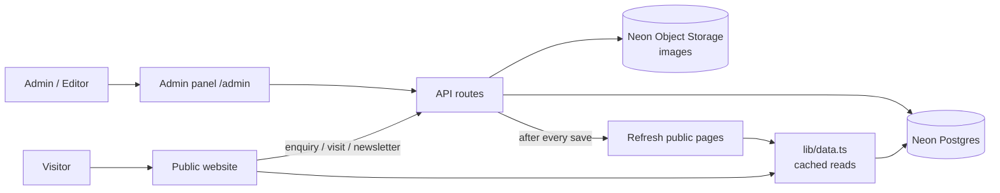
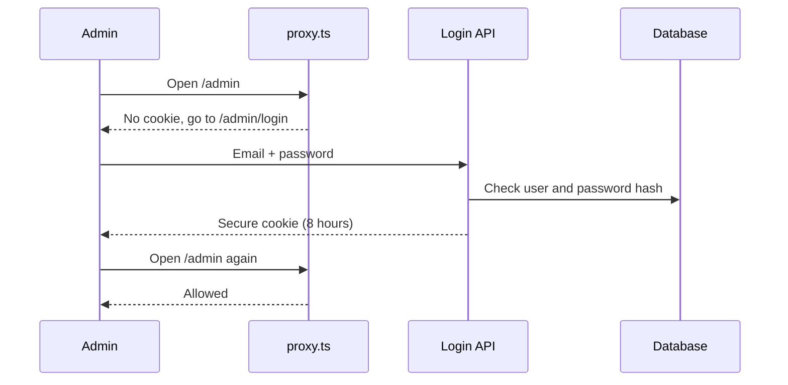

# Admin Panel: Progress and Structure

## The goal
Staff log in to an admin panel, edit the website content, and the public site shows it straight away. No redeploy is needed.

## Status

| # | Step | Status |
|---|------|--------|
| 1 | Database design, import and admin seed scripts | Written. Needs your Neon URL to run |
| 2 | Login, sessions, route protection | Written. Needs your Neon URL to test |
| 3 | Public read APIs, pages switched to the database | Done. Falls back to the old JSON files with no database |
| 4 | Safer enquiry, visit booking and newsletter | Done. Validation tested; saving needs the database |
| 5 | Admin screens (all content, leads, users) | Done. Type-checked and builds; needs the database to use |
| 6 | Image upload, CSV import/export, activity log | Done. Needs the database and a storage bucket |

`npm run typecheck` and `next build` pass. Public pages and the validation rules were tested on a running server. **Nothing that touches the database has been run**, because no `DATABASE_URL` exists yet.

## Big picture



Without `DATABASE_URL`, `lib/data.ts` serves the old `content/` files, so the site still runs.

## Folder map

```
propstep-next/
├── prisma/schema.prisma        Database tables
├── proxy.ts                    Blocks /admin and /api/admin without a login
├── lib/
│   ├── data.ts                 Reads content for the public pages (cached)
│   ├── db.ts, auth.ts          Database + login session
│   ├── http.ts                 Validation, rate limit, origin check, role guard
│   ├── storage.ts, notify.ts   Image bucket, webhook + email
│   ├── search.ts               Listing filters and sorting
│   ├── validation/             common.ts, forms.ts (public), admin.ts (admin)
│   └── admin/                  Audit log, refresh pages, CSV, listing mapping
├── app/
│   ├── api/                    Public APIs
│   │   ├── listings, localities, areas, site, visit-slots   (read)
│   │   ├── enquiry, visits, newsletter/*                    (forms)
│   │   ├── media/[...key]                                   (private-bucket images)
│   │   └── admin/…                                          (login, CRUD, uploads, CSV)
│   └── admin/                  Admin screens
└── components/admin/           Admin UI pieces
```

## Admin screens

| Screen | What you can do | Who |
|---|---|---|
| Dashboard | New leads, upcoming visits, counts | Both |
| Listings | Create, edit, publish or unpublish, delete, photos, CSV import and export | Both |
| Localities, Search areas, Advisors | Create, edit, delete | Both |
| Site settings | Contact, address, social, stats, cities, offices, team, services and more | Both |
| Testimonials, FAQs | Add, reorder, edit | Both |
| Leads, Site visits, Subscribers | Change status, search, export CSV | Both |
| Users | Create, change role, disable, reset password | Admin |
| Activity log | Who changed what | Admin |

## Login and who can do what



- No signup exists. Accounts come from `npm run admin:create` or the Users screen.
- Every API checks the role itself, not just the screen.
- Wrong logins get one generic message and are rate limited.

## Form checks (all on the server)

| Form | Checks |
|---|---|
| Enquiry | Name, valid phone (Indian or `+country`), optional valid email, allowed enquiry type, consent ticked |
| Site visit | Same, plus: real date from tomorrow to 1 year ahead, no Sundays, valid slot and mode, listing must exist, 4 bookings max per slot |
| Newsletter | Valid email, confirmation email (if mail is set up) |
| All | Origin check, size cap, per-IP rate limit, honeypot, duplicate-submit key, control characters stripped |

A lead is saved before the visitor sees "success". With no database and no webhook, production answers "try again or call" instead of losing the lead.

## Admin input checks

Listings, localities, advisors, settings and users each have a schema in [lib/validation/admin.ts](../lib/validation/admin.ts). Examples: slug format and uniqueness, price above zero, smallest size not above largest, icon names must exist, photos must be uploads or https links, at least one photo to publish, passwords of 12+ characters, https-only social links.

## Setup (once)

1. Copy `.env.example` to `.env`. Fill `DATABASE_URL` (pooled), `DIRECT_URL`, `AUTH_SECRET` (`openssl rand -base64 32`).
2. `npm run db:migrate` to create the tables.
3. `npm run db:import` to load today's listings, localities, areas and site content.
4. `npm run admin:create -- --email you@propstep.in --password "<12+ chars>" --role ADMIN`
5. For image uploads, create a bucket in Neon (use `public_read` for the simplest setup), run `neon env pull`, and fill `STORAGE_BUCKET` and `STORAGE_PUBLIC_URL`.
6. Optional: `RESEND_API_KEY`, `MAIL_FROM` and `NOTIFY_EMAIL` for emails; `ENQUIRY_WEBHOOK_URL` for a CRM or Slack feed.
7. Sign in at `/admin/login`.

## Known limits

- The rate limiter is in memory. On Vercel each instance counts on its own, so it slows floods but is not a hard cap. Use Upstash or Redis for a global limit.
- No CAPTCHA yet (needs a Turnstile site key). The honeypot, rate limit and origin check are in.
- The Properties page still filters in the browser (the list is small). `GET /api/listings` is ready for when it needs paging.
- Unit types, amenities and connectivity on the listing form, and the content blocks under Site settings, are edited as JSON with examples. The server rejects anything invalid.
- Neon Object Storage is in beta. Not every S3 operation is available.
- Listing floor-plan "3D" images still come from `public/floorplans`.
